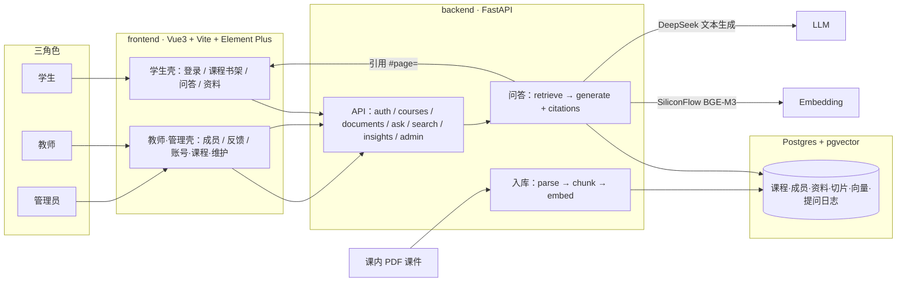
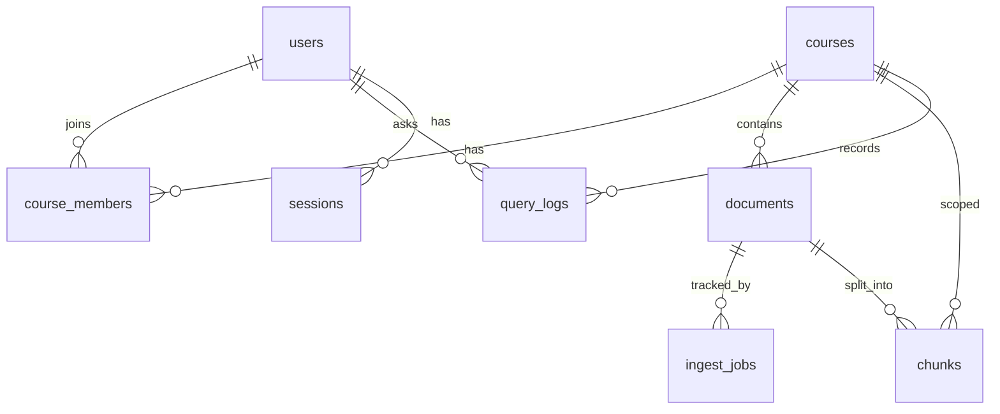
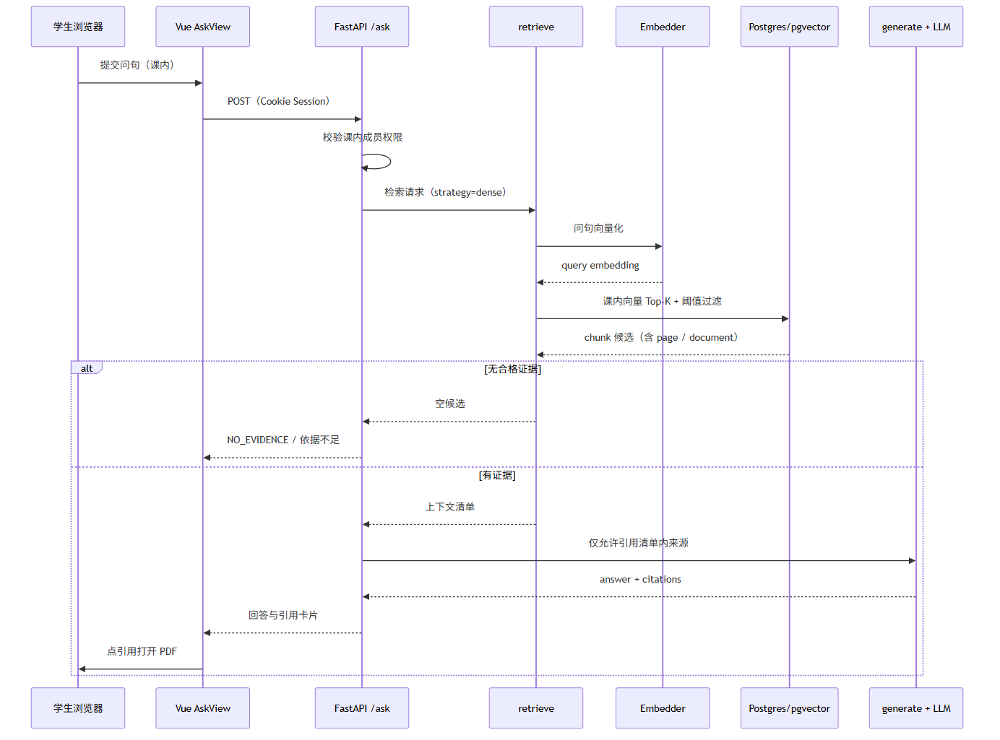
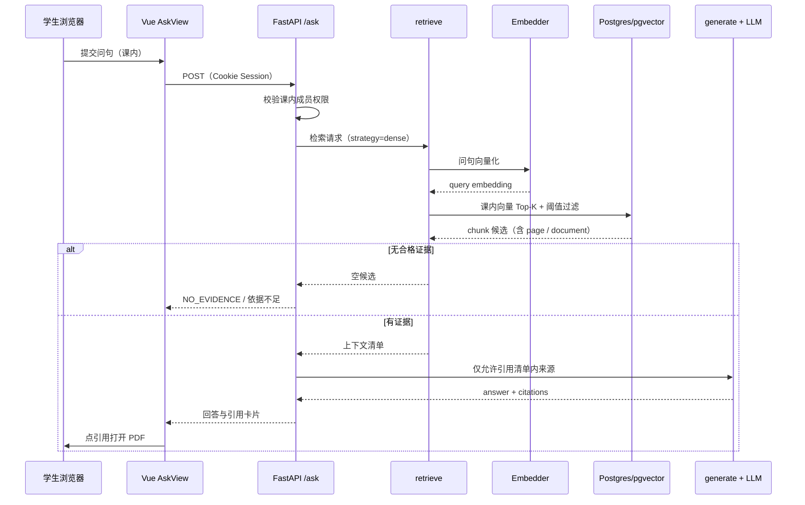

# 系统架构（中期 · 详解）

更新：2026-10-20。描述**当前已落地**的本机原型，供中期汇报与团队对齐。不堆未实现组件。

## 1. 边界（先说清楚）

- **当前实现尚未包含**：OCR、通用多模态/图表理解、Agent 编排/运行时、GraphRAG、生产级多租户部署。教师侧 Agent 已拍板进结题主线但尚未落地；**GraphRAG/知识图谱结题不做**。以 [结题已拍板规格](结题已拍板规格.md)、[教师 Agent 代码审查](teacher-agent-current-code-audit.md) 和 [结题施工计划](implementation-plan.md) 为准。
- **默认检索**：dense（向量）；**rerank 默认关闭**（`RERANKER_BACKEND=disabled`）。
- **题集指标**：AI 预标 + 弱引用支持规则 ≠ 人工事实正确率。
- **引用闭环**：回答附课内引用；前端打开原 PDF，URL 含 `#page=`。
- **正式演示库**：`univ_course_rag_cn_v2`（中文四课 **4 / 27 / 2,501**）。

操作步骤见 [中期演示运行卡](中期演示运行卡.md)；材料包见 [中期答辩材料](../中期答辩材料/README.md)。

## 2. 总览

静态图（mermaid 导出；**以本文为准**）：

**一条链路**：上传 PDF → PyMuPDF 抽文字 + 页级质量门禁 → `semantic-text-splitter` 切分 → SiliconFlow `BAAI/bge-m3` 写入 pgvector → 学生提问 dense 检索 → DeepSeek 基于证据生成并附引用 → 前端打开原 PDF 页。

## 3. 目录级模块

### 3.1 后端 `backend/app/`

| 路径 | 职责 |
| --- | --- |
| `main.py` | FastAPI 入口、路由挂载、统一错误码（配置不可用 / 上游失败 / 检索策略拒绝等） |
| `config.py` | Settings：`database_url`、`upload_dir`、embedder/llm/reranker 后端与模型 |
| `db.py` | SQLAlchemy 引擎与会话 |
| `seed.py` / `__main__.py` | `python -m app`：补演示账号（不重置已有密码） |
| `api/auth.py` | 登录 / 登出 / `me`；Cookie Session |
| `api/courses.py` | 课程列表、课内权限能力位 |
| `api/documents.py` | 上传、入库状态、原文件下载 |
| `api/ask.py` | 课内问答主入口 |
| `api/search.py` | 检索相关接口 |
| `api/insights.py` | 教师问答反馈聚合 |
| `api/users.py` / `admin_courses.py` / `query_log_retention.py` | 全局账号、课程授权、日志留存清理 |
| `services/parse.py` + `parse_quality.py` | PyMuPDF 解析与页级质量门禁 |
| `services/chunk.py` | 文本切分 |
| `services/embedder.py` / `llm.py` | Embedding / LLM 适配（含 Fake） |
| `services/ingest.py` | 入库编排：parse → chunk → embed → 写库 |
| `services/retrieve.py` / `fusion.py` / `keyword.py` | dense / hybrid 融合与关键词支路 |
| `services/generate.py` | 证据约束生成与引用装配 |
| `services/rerank.py` | 重排适配（**默认 disabled**） |
| `services/storage.py` | 上传文件落盘路径 |
| `models/` | 见下节表结构 |

### 3.2 前端 `frontend/src/`

| 路径 | 职责 |
| --- | --- |
| `router.js` | 路由与守卫（公开登录、admin、课内 capability） |
| `session.js` / `api.js` | 会话与 HTTP（Cookie） |
| `courseAccess.js` | 当前课权限缓存 |
| `answerMarkdown.js` / `citationDisplay.js` | 回答 Markdown / 引用展示 |
| `student.css` / `styles.css` | 学生壳与教师·管理壳样式 |
| `views/*` | 见「前后端路由对照」 |

## 4. 核心数据：课 → 文档 → chunk → 向量

| 表 | 关键字段（摘要） |
| --- | --- |
| `users` | `username`、`password_hash`、全局 `role`（admin/teacher/student） |
| `sessions` | `user_id`、`expires_at`（HTTP-only Cookie `session_id`） |
| `courses` | `title` |
| `course_members` | `course_id`、`user_id`、课内 `role`（teacher/student） |
| `documents` | `course_id`、`filename`、`storage_path`、抽取/切片计数、`quality_warning`、`chunking_version` |
| `ingest_jobs` | `document_id`、`status`（pending/running/succeeded/failed）、`error_message` |
| `chunks` | `course_id`、`document_id`、`page`、`text`、**`embedding`（1024 维 pgvector）**、`embedding_model`、`source_metadata` |
| `query_logs` | `course_id`、`user_id`、`query`、`hit`/`outcome`、`chunk_ids`、`duration_ms` |

关系口诀：**全局角色 ≠ 课内权限**；切片与提问都带 `course_id`，检索不得串课。

## 5. 一次提问时序

静态图：

要点：相似分数高 ≠ 依据充分；无合法引用时应拒答，不编造课外知识（如在线代课问 SQL）。

## 6. 关键配置

| 变量 | 中期演示建议 | 说明 |
| --- | --- | --- |
| `DATABASE_URL` / `POSTGRES_DB` | `…/univ_course_rag_cn_v2` | 与 docker-compose / `.env.example` 一致 |
| `UPLOAD_DIR` | `corpus/local/cn-replace-2026-10-18/rechunk/uploads_v2` | 27 份 PDF；引用打开依赖路径 |
| `EMBEDDER_BACKEND` | 演示 `siliconflow`（或环境已配）；**pytest=`fake`** | Fake 不证明语义效果 |
| `LLM_BACKEND` | 演示真实 DeepSeek；**pytest=`fake`** | 须当次授权 |
| `RETRIEVAL_STRATEGY` | `dense` | hybrid 有代码，演示以 dense 为准 |
| `RERANKER_BACKEND` | **`disabled`** | 默认关 |
| `QUERY_EXPANSION_BACKEND` | 演示可 `llm` | 按运行卡 |

密钥只放本机 `.env`，**不进 Git**。CI 使用 Fake + 临时 Postgres（库名 `univ_course_rag_cn_v2`）。

## 7. 前后端路由 / 页面对照

| 角色 | 前端路由 | 视图 | 主要后端 |
| --- | --- | --- | --- |
| 公共 | `/login` | `LoginView` | `api/auth` |
| 学生/教师 | `/courses` | `CoursesView` 书架 | `api/courses` |
| 学生/教师 | `/courses/:id` | `AskView` 问答 | `api/ask`、`search` |
| 学生/教师 | `/courses/:id/documents` | `DocumentsView` | `api/documents` |
| 教师 | `/courses/:id/members` | `MembersView` | courses 成员 API |
| 教师 | `/courses/:id/insights` | `InsightsView` | `api/insights` |
| 管理员 | `/admin/users` | `AdminUsersView` | `api/users` |
| 管理员 | `/admin/courses` | `AdminCoursesView` | `api/admin_courses` |
| 管理员 | `/admin/maintenance` | `AdminMaintenanceView` | 日志留存等 |
| 管理员 | `/admin/system` | `AdminSystemStatusView` | `/runtime` 类状态 |

守卫逻辑：未登录跳转登录；`meta.admin` 需全局 admin；课内页按 `capabilities`（如 `can_manage_members`、`can_view_insights`）拦截。

## 8. 技术栈（仓库事实）

- **前端**：Vue 3、Vite、Element Plus、（回答侧）markdown-it / KaTeX
- **后端**：Python 3.12、FastAPI、SQLAlchemy、Alembic、PyMuPDF、semantic-text-splitter
- **数据**：PostgreSQL + pgvector（embedding 1024）
- **模型服务**：SiliconFlow `BAAI/bge-m3`；DeepSeek 文本生成（如 `deepseek-flash` / 供应商别名）

## 9. 相关文档

| 文档 | 用途 |
| --- | --- |
| [中期演示运行卡](中期演示运行卡.md) | 切库、启动、固定问句、故障降级 |
| [中期答辩材料](../中期答辩材料/README.md) | PPT / 讲稿 / 截图 / 图示 |
| [evaluation-results](evaluation-results.md) | 当前数字 stub；全文在 archive |
| [engineering](engineering.md) | 现行合同摘要 |
| [workflow](workflow.md) | 启动与测试精简入口 |
