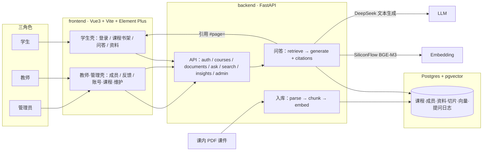

# 系统架构（中期答辩用）

更新：2026-10-20。本文只描述**当前已落地**的本机原型结构，供中期汇报与队友对齐；不堆类图、不引入未实现组件。

## 边界（先说清楚）

- **不做**：OCR、通用多模态/图表理解、Agent 编排、GraphRAG、生产级多租户部署。
- **默认检索**：dense（向量检索）；**rerank 默认关闭**（`RERANKER_BACKEND=disabled`）。
- **题集指标**：AI 预标 + 弱引用支持规则 ≠ 人工事实正确率；勿在答辩中宣称「准确率百分之多少」。
- **引用闭环**：回答附带课内资料引用；前端可打开原 PDF，URL 含 `#page=` 页锚。
- **正式演示库**：`univ_course_rag_cn_v2`（中文四课 4 / 27 / 2,501）。细节见 [中期演示运行卡](中期演示运行卡.md)、[结果登记](evaluation-results.md)、[中期答辩材料](../中期答辩材料/README.md)。

## 总览

静态图（由下方 mermaid 导出，**以本文 mermaid 为准**）：

**一条链路**：上传 PDF → PyMuPDF 抽文字 + 页级质量门禁 → `semantic-text-splitter` 切分 → SiliconFlow `BAAI/bge-m3` 写入 pgvector → 学生提问时 dense 检索 → DeepSeek 基于证据生成并附引用 → 前端打开原 PDF 页。

## 模块对照

| 层 | 主要对象 | 职责 |
| --- | --- | --- |
| 前端学生壳 | `LoginView` / `CoursesView` / `AskView` / `DocumentsView` + `student.css` | 登录、书架、提问与引用回页、资料列表 |
| 前端教师·管理壳 | `MembersView` / `InsightsView`；`AdminUsers` / `AdminCourses` / `AdminMaintenance` / `AdminSystemStatus` | 成员与反馈；账号/课程授权/日志维护/运行状态 |
| API | `backend/app/api/`：`auth`、`courses`、`documents`、`ask`、`search`、`insights`、`users`、`admin_courses`、`query_log_retention` | Cookie Session；课内角色鉴权；上传与原文件；问答与检索；反馈聚合 |
| 服务 | `backend/app/services/`：`parse` / `chunk` / `embedder` / `ingest` / `retrieve` / `fusion` / `generate` / `llm` / `rerank`(默认关) / `keyword` / `storage` 等 | 解析入库、检索融合、生成与拒答、可选重排适配 |
| 模型层 | `backend/app/models/`：`user` / `session` / `course` / `document` / `query_log` 等 | SQLAlchemy 映射；向量列经 pgvector |
| 外部服务 | SiliconFlow `BAAI/bge-m3`；DeepSeek 文本生成（如 `deepseek-v4-flash` / 供应商别名） | 真实调用须当次授权；pytest 默认 FakeEmbedder / FakeLLM |
| 课件目录 | `corpus/local/cn-replace-2026-10-18/rechunk/uploads_v2/` | 中期 27 份 PDF；运行设 `UPLOAD_DIR` |

技术栈以仓库为准：**Vue 3 + Vite + Element Plus**；**FastAPI + SQLAlchemy + Alembic**；**PostgreSQL + pgvector**。不另造检索中台或消息队列。

## 权限要点

- 登录：HTTP-only Cookie `session_id` + 服务端 Session（非 JWT）。
- 全局角色 ≠ 自动课内权限；读写课内容看 `CourseMember.role`。
- 仅 admin 可管理全局账号；课内教师管资料/成员/反馈。

## 相关文档

| 文档 | 用途 |
| --- | --- |
| [中期演示运行卡](中期演示运行卡.md) | 切库、启动、固定问句、故障降级 |
| [中期答辩材料](../中期答辩材料/README.md) | 队友 PPT / 讲稿 / 截图 |
| [evaluation-results](evaluation-results.md) | 已跑数字与历史口径 |
| [engineering](engineering.md) | 现行代码合同 |
| [implementation-plan](implementation-plan.md) | 施工顺序与 R9 收口状态 |

